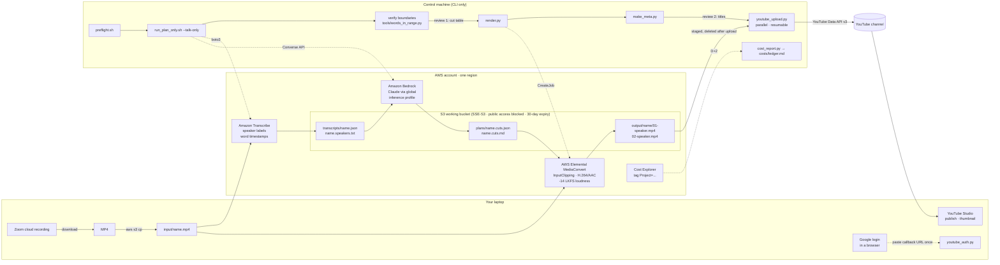

# meetup-video-publish

Turn one long Zoom meetup recording into one YouTube-ready video per speaker, with the host
intro, hand-overs, Q&A and dead air removed. Everything heavy runs on AWS (Transcribe, Bedrock,
MediaConvert); the machine you run the scripts on only drives the APIs and never holds the video,
except for a short upload staging step.

Built for a monthly online meetup with two talks per session, but nothing is specific to that
number: the planner emits one output per presenter it finds.

## How it works



| Stage | Service / script | What it does | Notes |
|---|---|---|---|
| Ingest | `scripts/ingest.sh` or plain `aws s3 cp` | Put the recording at `input/<name>.mp4` | `ingest.sh zoom` streams via `yt-dlp` when the recording is reachable; SSO-protected recordings need browser cookies or a manual download |
| Transcribe | `scripts/transcribe.py` -> Amazon Transcribe | Speaker labels (`spk_N`) + word-level timestamps | Multi-language identification; inputs over 2 GB are first reduced to audio with MediaConvert |
| Plan | `scripts/plan_cuts.py` -> Bedrock Claude | Identify host / presenters / audience, emit keep-segments per presenter as strict JSON | Default model Claude Opus (falls back to Sonnet). `--talk-only` drops every Q&A and host remark, including mid-talk interruptions |
| Verify | you + `tools/words_in_range.py`, `tools/inspect_cuts.py` | Re-set each segment boundary from word timestamps | Do not skip: the model estimates boundaries inside long speaker turns from text position and can be ~10 s off |
| Render | `scripts/render.py` -> MediaConvert | One job per presenter, keep-segments concatenated with `InputClippings` | Source resolution and frame rate, H.264 QVBR 8 (max 12 Mbps), AAC 192 kbps, loudness -14 LKFS, length error < 0.2 s |
| Publish | `scripts/make_meta.py`, `scripts/youtube_auth.py`, `scripts/youtube_upload.py`, `scripts/youtube_update_meta.py` | Metadata skeleton -> OAuth once -> parallel resumable uploads | Uploads from an unverified OAuth app are forced to **private**; publish from Studio |
| Cost | `scripts/cost_report.py` -> Cost Explorer | Per-run actual cost into `costs/ledger.md` | Bedrock calls cannot carry tags, so they are estimated from the token counts stored in the plan |

## Setup

### AWS

1. Credentials with permission for S3, Transcribe, MediaConvert (+ `iam:CreateRole`/`PutRolePolicy`
   once, for the MediaConvert service role), Bedrock `InvokeModel`/`Converse`, Cost Explorer (optional),
   Pricing (optional). Use whatever your organization uses: `aws configure`, `aws sso login`, or an
   `AWS_PROFILE`. The scripts call the AWS CLI and boto3 with the default credential chain.
2. Bedrock model access for the Claude models you want (see `PREFERRED` in `scripts/plan_cuts.py`).
   `scripts/plan_cuts.py --probe` prints which one answers.
3. A working bucket in your region, private, encrypted, with a lifecycle rule so forgotten media
   expires:

   ```bash
   export ZVE_BUCKET=my-meetup-video-bucket ZVE_REGION=ap-northeast-2
   aws s3api create-bucket --bucket "$ZVE_BUCKET" --region "$ZVE_REGION" \
     --create-bucket-configuration LocationConstraint="$ZVE_REGION"
   aws s3api put-public-access-block --bucket "$ZVE_BUCKET" --public-access-block-configuration \
     BlockPublicAcls=true,IgnorePublicAcls=true,BlockPublicPolicy=true,RestrictPublicBuckets=true
   aws s3api put-bucket-encryption --bucket "$ZVE_BUCKET" --server-side-encryption-configuration \
     '{"Rules":[{"ApplyServerSideEncryptionByDefault":{"SSEAlgorithm":"AES256"}}]}'
   aws s3api put-bucket-lifecycle-configuration --bucket "$ZVE_BUCKET" --lifecycle-configuration \
     '{"Rules":[{"ID":"expire-30d","Status":"Enabled","Filter":{"Prefix":""},"Expiration":{"Days":30},"AbortIncompleteMultipartUpload":{"DaysAfterInitiation":2}}]}'
   aws s3api put-bucket-tagging --bucket "$ZVE_BUCKET" --tagging 'TagSet=[{Key=Project,Value=zoom-video-edit}]'
   ```

   `scripts/render.py --ensure-role` creates the MediaConvert service role (trusts
   `mediaconvert.amazonaws.com` from your account only; read `input/ test/`, write `output/` on this bucket).
4. If you want `cost_report.py`, activate `Project` as a cost-allocation tag in the Billing console once.

### Local

```bash
cp .env.example .env && $EDITOR .env && source .env
uv venv ~/.cache/zoom-video-edit/venv
uv pip install --python ~/.cache/zoom-video-edit/venv/bin/python -r requirements.txt
# optional: a static ffmpeg lets render.py detect the source frame rate (otherwise pass --fps)
cp "$(uvx --from imageio-ffmpeg python -c 'import imageio_ffmpeg;print(imageio_ffmpeg.get_ffmpeg_exe())')" \
   ~/.cache/zoom-video-edit/ffmpeg
```

All local state lives under `~/.cache/zoom-video-edit/` (venv, ffmpeg, plan copies, YouTube token).

### YouTube (once)

1. Google Cloud Console -> a project -> enable **YouTube Data API v3**.
2. OAuth consent screen: External, Testing, add the channel-owning Google account as a test user.
   Publishing the app to Production (no review needed for personal use) makes the refresh token
   permanent; in Testing it expires after 7 days.
3. Credentials -> OAuth client ID. A **Desktop app** client works with the default
   `http://localhost:8765/` redirect. A Web application client also works: set `YT_REDIRECT` to one
   of its registered redirect URIs.
4. Save the downloaded JSON as `~/.cache/zoom-video-edit/youtube/client_secret.json` (mode 600).
5. Log in from any browser, no local web server needed:

   ```bash
   scripts/youtube_auth.py url        # open the printed URL, sign in, allow
   scripts/youtube_auth.py finish '<the full URL the browser lands on, even if it shows an error page>'
   scripts/youtube_auth.py whoami     # prints the channel the token belongs to
   ```

Videos longer than 15 minutes need a phone-verified channel.

## Monthly run

```bash
source .env
NAME=meetup-2026-10

# 0. the recording goes to S3 (from the laptop that downloaded it)
aws s3 cp ~/Downloads/recording.mp4 s3://$ZVE_BUCKET/input/$NAME.mp4 --region $ZVE_REGION

# 1. everything in place?
scripts/preflight.sh $NAME

# 2. transcribe + plan (no render yet); --talk-only removes all Q&A and host remarks
scripts/run_plan_only.sh $NAME --talk-only

# 3. verify boundaries against word timestamps, then edit the plan locally
aws s3 cp s3://$ZVE_BUCKET/transcripts/$NAME.json ~/.cache/zoom-video-edit/
aws s3 cp s3://$ZVE_BUCKET/plans/$NAME.cuts.json ~/.cache/zoom-video-edit/
tools/words_in_range.py ~/.cache/zoom-video-edit/$NAME.json 00:07:50-00:08:10 00:27:00-00:27:30
tools/inspect_cuts.py   ~/.cache/zoom-video-edit/$NAME.json --gaps 15        # long silences
$EDITOR ~/.cache/zoom-video-edit/$NAME.cuts.json                             # fix start/end to the word

# 4. render (one MediaConvert job per presenter, sequential)
scripts/render.py $NAME --plan ~/.cache/zoom-video-edit/$NAME.cuts.json

# 5. titles / descriptions, then upload both in parallel (lands as private)
scripts/make_meta.py $NAME --date 2026-10-28 --event "My Monthly Meetup"
$EDITOR ~/.cache/zoom-video-edit/youtube/$NAME.meta.json                     # fill every TODO
scripts/youtube_upload.py ~/.cache/zoom-video-edit/youtube/$NAME.meta.json

# 6. two days later: actual cost into costs/ledger.md
scripts/cost_report.py $NAME --from 2026-10-28 --to 2026-10-29
```

`scripts/run_all.sh <name>` runs transcribe -> plan -> render without the review stop, for cases
where you trust the plan. Every stage is idempotent: an existing S3 artifact is reused unless you pass
`--force`.

### Plan format

`plans/<name>.cuts.json` is the contract between the planner, your review and the renderer
(`examples/cuts.example.json`). Each presenter has an ordered list of `segments`
(`HH:MM:SS.mmm` start/end); the renderer concatenates exactly those. To drop something in the middle
of a talk, split the segment. `_meta.usage` keeps the token counts for the cost report.

Review checklist the planner is asked to follow and you should verify:

- start at the presenter's first content sentence, not the host's hand-over or "can you see my screen?"
- end at the presenter's last talk sentence (`--talk-only`) or after the last Q&A answer (default)
- drop silences over 20 s, breaks, screen-share trouble, and (talk-only) any other-speaker exchange
  over ~3 s; sub-3 s reactions ("yes", "right") are kept because cutting them is more jarring
- pad boundaries by ~0.3 s and land them on a sentence edge

## Running it with an AI agent

The monthly run is written up as an agent runbook, so you can hand the whole thing to a coding
agent and only answer its two approval questions (the cut table before rendering, the titles and
descriptions before uploading).

| Tool | What it reads | Notes |
|---|---|---|
| Codex | `AGENTS.md` (automatic) and `.agents/skills/meetup-video-publish` | — |
| Claude Code | `CLAUDE.md` → `@AGENTS.md`, `.claude/skills/meetup-video-publish` | the skill is picked up when the request matches its description |
| Kiro / Kiro Crew | `.kiro/skills/meetup-video-publish` (project skill) | or copy `skills/meetup-video-publish/` to `~/.kiro/skills/` for every project |
| anything else | `AGENTS.md` | the three skill paths are symlinks to `skills/meetup-video-publish/SKILL.md` |

A typical session: *"The recording is at s3://…/input/meetup-2026-11.mp4, here is the event
announcement, edit and upload."* The agent runs preflight, transcribes and plans, verifies every
boundary against word timestamps, shows you the cut table, renders after your approval, drafts the
metadata from the transcript, uploads after your second approval, and schedules the cost report.

`scripts/youtube_update_meta.py <videoId> --replace OLD NEW` fixes the title/description of a
video that is already up (a mis-spelled name, for instance). It needs the `youtube.force-ssl`
scope, which `youtube_auth.py` requests since v0.2; a token issued earlier has to be re-issued once.

## Cost (one 80-minute recording, two presenters, ap-northeast-2, 2026-10)

| Item | Approx. | Note |
|---|---|---|
| Transcribe batch | $0.12 | $0.006 per audio minute |
| Bedrock plan | $0.3-0.8 | ~34K input tokens per 80 min; depends on model and number of plan runs |
| MediaConvert | $1.3 (1080p) / $4.0 (above 1080p) | Billed per **output** minute: HD tier ~$0.017/min, UHD tier ~$0.056/min. A 2880x1800 Zoom share is UHD-tier; pass a 1920-wide output if you want the HD rate |
| S3 | < $0.05 | 30-day lifecycle |
| **Per run** | **≈ $2-5** | A second render roughly doubles the MediaConvert line |

`tools/pricing_lookup.py` queries the Pricing API for the current list prices in your region.

## Limitations

- Zoom recordings restricted to authenticated users cannot be fetched by `yt-dlp` without the
  browser's session cookies; downloading in the browser and running `aws s3 cp` is the simplest path.
- Speaker diarization occasionally merges two speakers or splits one; the cut table (`plans/<name>.cuts.md`)
  is written to be read before rendering, so check it.
- The planner is a language model: it finds the right turns reliably but places boundaries inside
  long turns approximately. The word-timestamp check is part of the workflow, not optional.
- YouTube forces `private` on uploads from OAuth apps that have not passed Google's audit; switch
  visibility in Studio after checking the processed video.

## Layout

```
scripts/   pipeline stages and entry points (see table above)
tools/     word-level timestamp inspection, pricing lookup, presigned PUT helper
examples/  cuts.example.json, meta.example.json
costs/     ledger written by cost_report.py (ignored by git)
AGENTS.md  runbook for coding agents (Codex reads it directly; CLAUDE.md imports it)
skills/    Agent Skill (SKILL.md); .agents/ .claude/ .kiro/ link to it
```

## License

MIT
